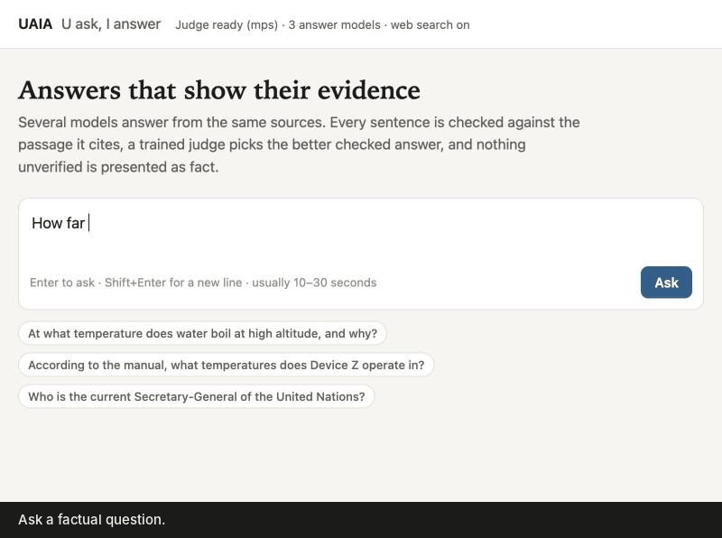

# UAIA — U ask, I answer

Hi there, and thanks for stopping by! 👋

I'm **Neeraj Yadav**, a master's student in Computer Science at the University of Kansas. Most of my work is in machine learning: deep reinforcement learning, HPC job scheduling research, and applied ML projects like this one.

This repository is **UAIA**, short for *"U ask, I answer"*. Let me walk you through what it does, why I'm building it, how it works, and where it stands today.

> **Heads up: this is a work in progress.** Version 1 runs all 13 steps end to end on my computer, but I haven't reached the project's goal yet. [Where it stands](#where-it-stands) lists what works today and what I'm still working on.

## The idea

You ask a question. UAIA gets several language models to answer it from the same evidence, checks every sentence against the passage it cites, and then a judge model I fine-tuned picks the better of the checked answers.

A few rules I hold it to:

- An answer with a contradicted sentence is never chosen.
- An answer where the checker could confirm at least four of every five sentences can still be returned, but it's labeled *partly verified* and its unconfirmed sentences are marked.
- If no answer passes the checks, the app says so instead of guessing.



These are screenshots from one live run on 8 October 2026. You can also [watch the 70-second walkthrough (MP4)](docs/UAIA_demo.mp4).

## Why I'm building this

Large language models write fluent answers that aren't always backed by any source. I wanted to treat answering as a pipeline you can inspect step by step: gather the evidence first, require a citation on every sentence, check each sentence against what it cites, and only then compare the answers that survive. Every step records what it did and what it couldn't check.

## Where it stands

**My goal:** a question-answering product other people can use. It asks several AI models, gathers evidence, checks every answer against that evidence, and returns the best-supported answer (or says plainly that it can't) within a set time and cost budget. The promise is better-supported answers, not perfect truth.

**Where I am (October 2026):** version 1, the first complete end-to-end version, is built and tested on one computer. It shows the whole pipeline working. The measurement, evidence-grounded judging and hosting that would turn it into a product for other people are what I'm working on next.

What's done:

- [x] All 13 steps run end to end: web search and saved documents, cited answers from up to three models, a model-based check of every sentence against its cited passages, the trained judge, a final recheck, and a local web page with sources, checks, timing and cost
- [x] A fine-tuned judge (Qwen3-4B with LoRA) that agrees with human preferences on 81.0% of 311 validation pairs, up from 76.5% before fine-tuning
- [x] A per-question spending cap and cost tracking, including web search
- [x] Opt-in feedback, stored locally and only with consent
- [x] 121 automated tests that run without network access

What I'm still working on:

- [ ] Run the reserved final test (769 pairs) and calibrate the judge's probabilities
- [ ] Measure the app itself: the factual accuracy and completeness of its answers, source reliability, and the sentence checker's own error rate
- [ ] An evidence-grounded judge. Today's judge learned general answer preferences; comparing answers against their sources needs a source-based dataset with human review
- [ ] Learned question understanding and cost-aware model routing (steps 1–3 use rules today)
- [ ] More answer providers (Gemini, DeepSeek), general claim extraction, and checkers for calculations and code
- [ ] Combining the best-supported parts of several answers (step 10 picks one answer today)
- [ ] Hosting it as a service, with review and export tools for feedback

The step-by-step detail is in [docs/build_status.md](docs/build_status.md).

## How it works: 13 steps

```mermaid
flowchart LR
    Q([Question]) --> S1[1 Understand] --> S2[2 Freshness] --> S3[3 Route]
    S3 --> S5[5 Retrieve evidence<br/>web search and saved documents]
    S5 --> S4[4 Ask models in parallel]
    S4 --> S6[6 Normalize]
    S6 --> S7[7 Split into cited sentences]
    S7 --> S8[8 Verify each sentence<br/>against its cited passage]
    S8 --> S9[9 Trained judge<br/>Qwen3-4B + LoRA]
    S9 --> S10[10 Select]
    S10 --> S11[11 Recheck the outgoing text]
    S11 --> S12([12 Respond with sources])
    S12 --> S13[13 Consented feedback]
```



You'll notice step 5 runs before step 4. That's on purpose: every model sees the same evidence.

| Step | What happens | Code |
| --- | --- | --- |
| 1–2 | Rule-based task labels and a freshness decision (current events go to the web) | `answerlab/steps.py` |
| 3 | Route to saved documents, web search, or both; pick the answer models | `answerlab/pipeline_v1.py` |
| 4, 6 | Concurrent calls to Claude Sonnet 5.5, GPT-6.1 Sol and Claude Haiku 5.5 with timeouts and a spending cap, normalized into records | `answerlab/providers.py`, `pipeline_v1.py` |
| 5 | Web search (Tavily) plus keyword search over saved documents, trimmed to fit the prompt | `answerlab/web_search.py`, `retrieval.py` |
| 7 | Split each answer into sentences with their citations | `answerlab/claims_cited.py` |
| 8 | One batched call per answer labels every sentence SUPPORTED, CONTRADICTED or NOT_ENOUGH_INFO against its cited passages; a contradicted sentence disqualifies the answer | `answerlab/verify_semantic.py` |
| 9–10 | Answers that pass go to the trained judge, which compares them pairwise in both answer orders | `judge_server/`, `answerlab/judge_client.py` |
| 11 | The outgoing text and its source fingerprints must match exactly what was checked | `pipeline_v1.py` |
| 12 | Answer, sources, sentence-by-sentence checks, the judge's reading, timing and cost | `webapp/` |
| 13 | Optional rating, stored locally only with consent and never used for training automatically | `answerlab/feedback.py` |

## The judge I trained (step 9)

The judge is `Qwen3-4B-Instruct-2507` with a rank-16 LoRA adapter on all seven projection layers in all 36 blocks. It reads a question and two answers and scores the next token "A" against "B" with a float32 head. I score each pair in both answer orders and average the two, which removes position bias by construction. I fine-tuned it on human preference pairs from HelpSteer2-Preference (600 pairs in both orders, learning rate 2e-5, checkpoint chosen on a separate 200-pair monitor).

I measured it on 311 held-out validation pairs with clear human preferences. Accuracy here means agreement with people: how often the judge picks the answer the human raters preferred.

| Model | Accuracy (agreement with human preference) | Log-loss | AUC |
| --- | --- | --- | --- |
| Unchanged Qwen3-4B | 238/311 (76.5%) | 1.169 | 0.804 |
| **Fine-tuned judge (used in the app)** | **252/311 (81.0%)**, 95% interval 76.6–85.2% | **0.450** | **0.871** |
| Same recipe, 3,600 pairs (full-data run on A100) | 243/311 (78.1%) | 0.417 | 0.890 |

What I learned from the experiments:

- **More data did not raise accuracy.** Training on six times as many pairs improved probability quality but not accuracy, and accuracy on the training-side monitor stopped improving after about 2,400 pairs. Averaging the two judges gave 251/311, also no gain.
- **The remaining errors are hard ones.** 42 of the 311 pairs are missed by both judges. The weakest group is pairs where the shorter answer won (68% correct), so a preference for longer answers is the main remaining error.
- **Answer-order consistency improved** from 64% to 83% of clear pairs, so the judge is much less swayed by which answer comes first.

To be clear, the 81% is not the factual accuracy of the app's answers. I haven't measured how reliable the sources are, whether answers are complete, or how often the sentence checker itself is wrong yet.

These are development measurements on a validation set I used during model selection. I haven't touched the reserved test split (769 pairs) yet; `judge_server/final_test.py` runs it exactly once on the locked adapter, with the same prompts and metric code as validation, and writes the result to `model selection/FINAL_TEST_RESULTS.md`.

## A live example (the run in the demo)

Question: *"How far is the James Webb Space Telescope from Earth, and why is it there?"*

Three models answered from the same five web sources. The checker confirmed every sentence of all three answers: 7/7 for Claude Sonnet 5.5, 3/3 for GPT-6.1 Sol and 6/6 for Claude Haiku 5.5. The trained judge then ran a two-round knockout on an Apple M1 Pro GPU: Sonnet over GPT-6.1 Sol (p = 0.77), then Sonnet over Haiku (p = 0.51). The second round was a close call where the two answer orders disagreed (0.42 and 0.61), which is exactly why I score every pair both ways and average.

That question took 17.3 seconds and cost about 2.3 cents. Questions so far have taken 13–18 seconds and 1.6–2.4 cents. Those figures count the model calls only; each web search adds about 0.8 cents, which the app now includes in its budget and cost.

## Try it yourself

You'll need Python 3.11+, API keys for Anthropic and/or OpenAI, and a Tavily key for web search. The local judge runs on an NVIDIA GPU (CUDA), Apple Silicon (MPS) or, slowly, the CPU; it picks the first one available, and `JUDGE_DEVICE=cuda ./run_v1.sh` (or `--device` when starting `judge_server`) lets you choose. Without the judge, the app falls back to a rule-based tie-break.

```bash
python3 -m venv .venv && .venv/bin/pip install -e .
cp .env.example .env          # then add your keys; .env is never committed
.venv/bin/python -m unittest discover -s tests     # 121 tests, no network
```

Optional judge setup:

```bash
python3 -m venv "model selection/.colab-venv"
"model selection/.colab-venv/bin/pip" install -r "model selection/colab/requirements.txt" huggingface_hub
"model selection/.colab-venv/bin/python" "model selection/download_model.py"   # pinned Qwen3-4B weights
# put the trained adapter folder at: model selection/models/judge_adapter/
```

Prices and the spending cap live in `examples/live_config_v1.json`: per-million-token prices for each model, `search_usd_per_call` for one web search, and `max_estimated_usd` per question. Please check them against current provider pricing; live web search refuses to run without a search price.

Start the judge and the web page together, then open http://127.0.0.1:8000:

```bash
./run_v1.sh
```

Other entry points:

```bash
.venv/bin/python -m answerlab answer --allow-network "Who is the current Secretary-General of the United Nations?"
.venv/bin/python -m answerlab demo        # offline demo with saved teaching examples, no API calls
"model selection/.colab-venv/bin/python" -m judge_server.parity_check   # served prompts == training prompts (needs the prepared data)
"model selection/.colab-venv/bin/python" -m judge_server.final_test --smoke 3   # check the final-test run on 3 validation pairs
"model selection/.colab-venv/bin/python" -m judge_server.final_test             # the one-time final test (about an hour)
```

The trained adapter (about 130 MB) isn't stored in this repository.

## What it can't do yet

- The sentence checker is itself a language model (Claude Haiku 5.5). It's a model-based check, not proof, and it doesn't judge how reliable a source is.
- A partly verified answer still contains statements nobody confirmed: up to one sentence in five may be unconfirmed (never contradicted). They're marked, not removed.
- The judge learned general answer preferences, not evidence-grounded comparisons, and its probabilities aren't calibrated. Its 81% is agreement with human preferences, not a measure of the app's factual accuracy, which I haven't measured yet.
- Step 10 selects one answer; merging answers is future work.
- Creative writing, calculations and code are declined in this version because they need different checkers (no source can confirm a poem; math needs a calculator; code needs tests).
- It runs on one computer; it isn't a hosted service yet.

## How the repo is organized

| Path | Contents |
| --- | --- |
| `answerlab/` | The 13-step pipeline: providers, web search, claim splitting, verification, judge client, CLI |
| `judge_server/` | Local HTTP server for the trained judge, the prompt parity check and the one-time final test |
| `webapp/` | The local web page |
| `tests/` | Automated tests (mocked network) |
| `examples/` | Model configuration and a small saved document collection |
| [`docs/`](docs/README.md) | Overview, build status, evaluation plan, datasets, research papers, design notes for each step, and the demo |
| `model selection/` | Judge experiments: baselines, training, Colab notebooks, evaluation and reports |
| `Training Data/` | Preparation of HelpSteer2-Preference with group-safe splits |

If you want the bigger picture before reading code, start with [docs/overview.md](docs/overview.md).

## Credits

UAIA stands on some great open resources:

- [HelpSteer2 / HelpSteer2-Preference](https://huggingface.co/datasets/nvidia/HelpSteer2) by NVIDIA, CC BY 4.0, revision `990b2711a36180dd19d9c94b8627844866f8982a`.
- [Qwen3-4B-Instruct-2507](https://huggingface.co/Qwen/Qwen3-4B-Instruct-2507) by the Qwen team, Apache-2.0, revision `cdbee75f17c01a7cc42f958dc650907174af0554`.
- Web search by [Tavily](https://tavily.com). Answer models through the Anthropic and OpenAI APIs.

## Say hi

Thanks for reading this far! If you have questions, ideas, or spot something I got wrong, feel free to open an issue or reach out through my GitHub profile, [@neerajydv0908](https://github.com/neerajydv0908).

— Neeraj
