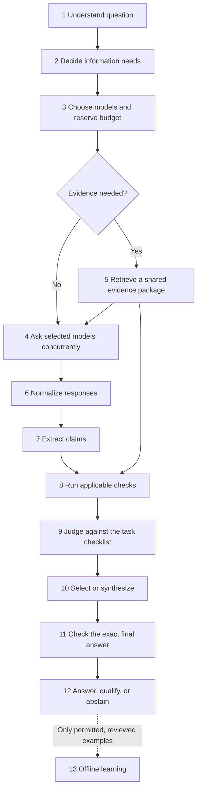

# Methodologies for our 13-step product

Prepared: 2026-09-28. **Status: design alternatives.** A narrow first prototype now exists. Current selections and exact implementation coverage are maintained in [MY Pick](<../my_picks/README.md>) and [BUILD_STATUS.md](../../build_status.md); the options here have not been compared in model-quality benchmarks.

This is the project's decision library: for each step it records the alternatives and an understandable starting approach, to be built in small increments. The goal is a product other people can use; a product, a trained judge, and a language model trained from scratch remain separate pieces of work.

## How to read this library

1. Read the [selection matrix](SELECTION_MATRIX.md) for the whole picture.
2. Open one step's `README.md` to understand its job and example.
3. Read `METHODS.md` to compare strategies, then `TOOLS_AND_MODELS.md` for concrete options.
4. Use `SELECTION.md` to see the suggested starting choice and how it would be tested.

Not every tool listed here is needed. Alternatives are choices, not a shopping list or an installation plan. “Recommended” means a sensible first experiment, not a measured winner.

## The folders

| Step | Folder | The question it answers |
| --- | --- | --- |
| 1 | [Understand the question](01_understand_question/README.md) | What is the user asking us to do? |
| 2 | [Decide whether fresh information is needed](02_freshness_decision/README.md) | Which information sources do we need? |
| 3 | [Select models](03_model_selection/README.md) | Which candidate generators are worth calling? |
| 4 | [Call models concurrently](04_concurrent_requests/README.md) | How do we ask them reliably at the same time? |
| 5 | [Retrieve evidence](05_evidence_retrieval/README.md) | How do we find relevant, trustworthy passages? |
| 6 | [Normalize answers](06_response_normalization/README.md) | How do different providers fit one record format? |
| 7 | [Extract claims](07_claim_extraction/README.md) | Which statements need checking? |
| 8 | [Verify](08_verification/README.md) | What do the sources and applicable tests support? |
| 9 | [Judge and score](09_answer_judging/README.md) | Which answers meet the requirements and compare best? |
| 10 | [Select or synthesize](10_selection_and_synthesis/README.md) | Do we keep an answer or write a combined one? |
| 11 | [Reverify the final answer](11_final_reverification/README.md) | Did the outgoing answer introduce a mistake? |
| 12 | [Present the result](12_response_and_uncertainty/README.md) | How do users see the answer, sources, and limitations? |
| 13 | [Learn from feedback](13_feedback_and_learning/README.md) | How do reviewed examples improve future versions? |

Every folder has the same four files. See the [model catalog](MODEL_CATALOG.md) for shared model choices and the [source register](SOURCES.md) for documentation and paper links. The existing [paper explanations](../../research_papers.md), [dataset plan](../../datasets.md), and [evaluation protocol](../../evaluation.md) remain our detailed references.

## The numbers describe responsibilities, not a rigid execution order

For a question about current facts or supplied documents, retrieve evidence before asking models to write grounded answers. A purely creative request may need no factual retrieval. Feedback belongs to a later, reviewed improvement process.

Failures can produce a limited answer or clarification instead of continuing blindly. Additional retrieval, model escalation, and repair consume the same request budget; they are not unlimited loops.

## Four recurring ideas

- **Baseline:** the simpler system that a new approach must improve upon.
- **Rubric:** a short checklist defining a good answer for this particular task.
- **Evidence:** a source passage we can inspect, with its origin and date.
- **Held-out data:** examples kept away from training or decision-making until their assigned evaluation stage.

A judge score is not a truth probability. Several models can share the same mistake. A link that opens may not support its attached claim.

## Where from-scratch training fits

Steps [9](09_answer_judging/METHODS.md) and [13](13_feedback_and_learning/METHODS.md) compare a small scorer trained from random weights, an adapted pretrained text judge, and an educational language model pretrained from scratch. None is silently substituted for another.

The next action after reviewing this library is to choose a small baseline. We will not implement all 13 advanced versions at once.
