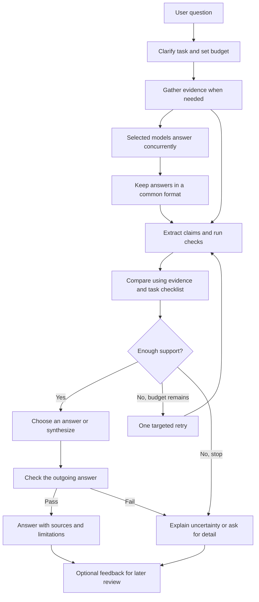

# Our multi-model answer product

**Current state, October 9:** version 1 of the product runs all 13 steps on this computer (released October 8; see [README.md](../README.md)). It answers from Tavily web search and saved documents, asks up to three answer models to cite every sentence, has a checker model test each sentence against all the passages it cites, lets the fine-tuned judge compare the answers that pass, rechecks the outgoing answer against every cited source, and shows the result on a local web page. On October 9 the six bugs found in a code review were fixed: a contradicting cited passage could be ignored, web search ran outside the budget, the final recheck covered only the first source, the judge never used an NVIDIA GPU, an exact judge tie was reported as a preference, and malformed judge replies crashed a run.

**Judge measurements:** the judge used in the app (learning rate `2e-5`, update 150, 600 training pairs) agrees with the human preference on **252/311 (81.0%)** clear validation pairs, versus **238/311 (76.5%)** for unchanged Qwen; log-loss **0.450 versus 1.169**. That is agreement with people's choice between two answers, not the factual accuracy of the product's answers, which has not been measured. The full-data A100 run (selected checkpoint after 3,600 pairs) reached 243/311 (78.1%) with lower log-loss (0.417): more data improved probability quality but not agreement, so the app keeps the earlier judge. [Measured results and limits](<../model selection/CORRECTED_JUDGE_COLAB_RESULTS.md>).

**Not done yet:** the reserved final test (769 pairs) has not been run, calibration has not been fitted, and source reliability, answer completeness and the sentence checker's own error rate have not been measured. Historical baseline v2 remains locked at 239/311.

Updated: 2026-10-09. The product, judge training, and foundation-model pretraining remain separate.

## Start here

This project builds a product that asks selected AI models for answers, gathers useful evidence, checks the answers, and returns the strongest supported response. The goal is a product other people can use.

Think of it as a small research team: several writers suggest answers, a researcher finds sources, a checker tests important claims, and an editor prepares the result. Our software coordinates that work.

The promise is **better supported answers within a time and money budget**. We cannot promise the best answer to every possible question, perfect truth, or state-of-the-art performance before testing.

Read this file first. The other notes are references.

**2026-10-06 roadmap update:** We replaced the 29-tie review with measurement-first development. Baseline v2 now uses all 396 validation pairs, A/B probabilities and two-order averaging, with 311 clear labels as the main grade and 85 ties kept diagnostic. All four fixed-weight evaluations and their audit completed: 3,168 valid score reads, with no new training. Original Qwen JSON matched 239/311 clear preferences (76.8%); plain text matched 236/311 (75.9%). The preregistered rule selects **JSON** for the next binary-training stage. Read [the measured results](<../model selection/BASELINE_V2.md>), [the comparable results table](<../model selection/EXPERIMENTS_V2.md>) and [the revised roadmap](<../model selection/JUDGE_ROADMAP_V2.md>).

To run the prototype, start with [README.md](../README.md). Our actual preferred choices are in [MY Pick](<design/my_picks/README.md>), and [BUILD_STATUS.md](build_status.md) separates working code from future capabilities. The architecture below describes the larger target, not a claim that every capability is already implemented.

| File | What it explains |
| --- | --- |
| [MY Pick/README.md](<design/my_picks/README.md>) | Our preferred methods and model choices for each step, with implementation status |
| [BUILD_STATUS.md](build_status.md) | Precisely what works and what remains pending |
| [Methodologies/README.md](design/methodologies/README.md) | Thirteen step folders, each with explanations, alternatives, tools/models, and a selection plan |
| [Methodologies/SELECTION_MATRIX.md](design/methodologies/SELECTION_MATRIX.md) | Proposed starting choices across all steps and the experiments needed to choose between them |
| [RESEARCH_PAPERS.md](research_papers.md) | The four research papers in plain language, including their limits |
| [DATASETS.md](datasets.md) | Training examples, test sets, and our own data plan |
| [EVALUATION.md](evaluation.md) | How we will know whether this product actually improves answers |
| [Diagrams/README.md](design/diagrams/README.md) | Review of the original diagrams and a simpler proposed flow |

## Three things we must distinguish

| Thing | Simple meaning | Our plan |
| --- | --- | --- |
| The product | The software connecting all the pieces | Build this ourselves, step by step |
| The judge model | A model that learns to assess candidate answers | Develop and test our own judge after we have useful data |
| A foundation language model | A model that learns language from huge amounts of text | Build a tiny version from scratch for learning; treat a competitive general model as a separate research investment |

Building this product does not require pretraining a new general language model. Training from scratch means starting with random internal numbers, called **weights**, instead of starting with an already trained model. **Fine-tuning** means teaching an existing model a more specific job. The current plan is to fine-tune an existing model for the product judge. A tiny from-scratch model remains an optional learning exercise.

## Proposed components

| Component | Its job | First version |
| --- | --- | --- |
| Existing LLM APIs | Ask models for candidate answers. An API is a way for programs to talk to other programs. | Two providers initially; add more when measurements justify them |
| MCP tools | Give our program a standard connection to tools and information | One small read-only tool connection after the basic flow works |
| Retrieval pipeline | Find and select passages relevant to the question | Small saved document collection, then controlled web search |
| Evidence-conditioned reward model | Read the question, answer, and evidence, then estimate answer quality | Start with explicit checks and a prompted judge; train our own later |
| Code/math/citation verifiers | Run checks appropriate to the task | Arithmetic and citation checks first; isolated code tests in a later milestone |
| Cost-aware router | Choose which models/tools are worth calling | Simple rules first; a learned router only after collecting measurements |
| Verified synthesis | Combine useful supported content and check the new answer | Return a winning answer first; add synthesis as a separate experiment |

**Evidence-conditioned** simply means that the judge gets the source material as well as the answer. It can check whether the source supports a claim instead of relying entirely on memory. A **reward model** usually outputs a score; it need not write the final answer.

## Where MCP fits

MCP stands for Model Context Protocol. It standardizes how an application connects to tools, resources, and reusable prompts. It does not decide which answer is correct or automatically train a model. Our product can act as the **host**, contain a **client** connection for each tool service, and call **servers** that expose search or document retrieval. [Official MCP architecture](https://modelcontextprotocol.io/docs/learn/architecture).

Use direct provider APIs for model generation, with a small **adapter** for each provider: a translator between that provider's response format and ours. MCP can wrap an API too, but that extra wrapper is useful only when it solves a real integration problem. OpenAI also supports remote MCP tools through its Responses API. [Official OpenAI MCP guide](https://developers.openai.com/api/docs/guides/tools-connectors-mcp).

Provider starting points: [OpenAI](https://developers.openai.com/api/docs/guides/tools), [Anthropic/Claude](https://docs.anthropic.com/en/api/overview), [Gemini](https://ai.google.dev/gemini-api/docs), [DeepSeek](https://api-docs.deepseek.com/), and [Perplexity](https://docs.perplexity.ai/). We will choose exact model IDs and verify prices when implementing each adapter. We are integrating provider APIs, rather than automating consumer chat websites.

Perplexity can supply search-backed answers. Any cited pages it returns still need inspection; its answer and its sources are not two independent confirmations.

## The 13 steps, with practical adjustments

| Step | What we will do |
| --- | --- |
| 1. Understand the question | Identify the requested task, ambiguity, risk, and language. Ask for clarification when a missing detail changes the answer. |
| 2. Decide about fresh information | Separate stable questions, current facts, and questions about supplied documents. Search only when appropriate. |
| 3. Select models | Use observed performance, capabilities, availability, and a spending limit. A famous brand is not a routing rule. |
| 4. Call models concurrently | Selected providers work at the same time. Start with two. An unavailable provider should not break the whole request. |
| 5. Retrieve evidence | For current or document-specific questions, retrieve evidence before asking for grounded answers. For other tasks, useful checks can run alongside generation. |
| 6. Normalize responses | Store answers in the same record format while retaining original text and provider metadata. Normalizing must not silently rewrite meaning. |
| 7. Extract claims | Split checkable statements apart, retaining conditions, dates, quantities, units, and which answer they came from. Opinions and creative choices need different treatment. |
| 8. Verify | Use the strongest applicable check. A working URL is not proof that its page supports the claim. |
| 9. Judge and score | Use a task-specific checklist, verifier results, and evidence. Hide provider names from the judge and vary answer order. |
| 10. Select or synthesize | Prefer an adequate original answer initially. Allow a tie, neither answer, or insufficient evidence. Combine only compatible supported statements. |
| 11. Recheck | Check the actual outgoing answer, including new claims introduced during synthesis. Failed verification triggers a bounded retry or an uncertainty response. |
| 12. Respond | Give the answer, source links where needed, and a plain explanation of important uncertainty. Avoid invented confidence percentages. |
| 13. Learn | Collect permitted feedback, review it, build a new training dataset, test a new version, and deploy only if it improves. No automatic learning from every thumbs-up. |

The main ordering change is step 5: fresh evidence often belongs **before** candidate generation. Providers can still run concurrently once they receive the same evidence package.

## Proposed flow

## What checking means

For a calculation, a calculator can check a number, but we must also check that we chose the right formula and units. For code, tests can check defined examples, but passing them does not prove all behavior is correct. For factual prose, source support requires interpretation and remains fallible.

We will record each claim as **supported**, **contradicted**, **insufficient evidence**, or **not applicable**. Missing evidence is not automatically evidence of falsehood. A supported claim can still depend on an unreliable or outdated source.

Do not average away a serious error. A beautifully written answer with a false central claim should fail the relevant correctness check before style is scored. Do not treat “unchecked” as “passed.”

Example using an invented document: a fictional manual says, “Device Z operates from 0 to 40 degrees Celsius.” Answer A says 0–60; Answer B says 0–40. The relevant passage supports B and contradicts A. We choose B even if A sounds more confident. With no manual, we should record the missing evidence instead of guessing that B is true.

## Product boundaries and reliability

Our proposed first engineering slice is English text Q&A with sources. The eventual audience and launch scope remain decisions to confirm. Images, video, autonomous actions, and general-purpose code execution each add new evaluation problems.

Every request needs a maximum spend, deadline, and tool/model call count. An initial prototype may allow two candidate calls and at most one targeted escalation; this is a design starting point, not a measured optimum. All retries, judges, search, and synthesis count toward the total budget.

Keep API keys on the server. Treat retrieved pages and candidate answers as data, including text that tells the judge to ignore its instructions. Only configured tools may run. A future code verifier needs isolation, resource limits, and no access to secrets. Tell users which services receive their data; collect training feedback by choice, with deletion and retention controls before a public launch.

## What we do next

The saved-answer demo uses authored examples and narrow quotation checks; it is not evidence of general model superiority. The live version answers real questions, but its quality has not been measured beyond the judge's agreement with human preferences.

The dataset audit, protected baseline, LoRA trials, corrected Colab training, the full-data A100 run and the v1 product are complete. **Proposed next steps, not yet decided:** run the reserved final test of the locked judge once; measure the sentence checker on a labeled sample of supported, contradicted and unclear sentences so its error rate is known; build a small question set with checked reference answers to measure the whole product's factual accuracy and completeness, including how often partly verified answers contain wrong statements; and record source reliability separately from support. A trained evidence-grounded judge and answer synthesis remain future work. The fictional evidence exercises still need independent human review.
